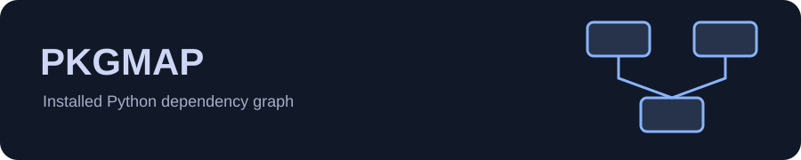

<div align="center"><h1>PkgMap</h1><p>See how installed Python packages depend on one another.</p></div>

## Features
- Read installed distribution metadata (does not import packages).
- Build dependency edges and flag requirements not installed.
- Print a dependency tree for one package.
- Export Mermaid graph or JSON.
- No pip, no package installation, no network calls.

## Run
```bash
python app.py
python app.py --tree requests
python app.py --mermaid packages.mmd
python app.py --json
```
Python 3.9+, standard library only. Dependency markers and version constraints are shown as declared metadata; this tool maps package names, not full resolver compatibility.

## Tests
```bash
python -m unittest discover -s tests -v
```
MIT License.